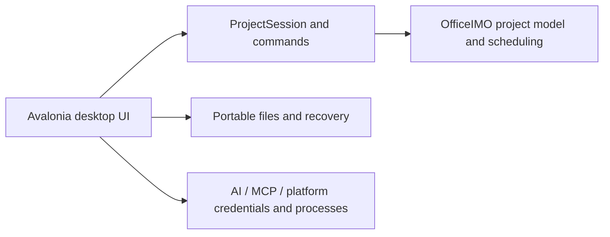

# Planora

**Clarity, from plan to progress.**

[Visual identity](docs/BRAND.md) · [Brand preview](docs/design/planora-brand.html)

An offline desktop project planner with spreadsheet-style task editing, linked Gantt charts, resources, baselines, multiple timelines, PDF export, local recovery and optional AI/MCP connections.

**Status:** Windows preview, version 0.3.10. The shared C#/.NET/Avalonia source is intended for macOS, but a Mac release has not been qualified. Android and iOS apps are planned **after the macOS app is completed and validated**. The delivery order is **Windows → macOS → Android and iOS**; mobile development has not started. This is not full Microsoft Project feature or file-format parity. Versions 0.3.0, 0.3.1 and 0.3.3 passed automated and native Windows stress checks on this machine. The public MPP regression corpus retains 10 pre-existing failures; full compatibility is not qualified.

## Latest additions

0.3.10 adds one-click Hide timelines / Show timelines above the Gantt and table. [Download the Windows preview](https://github.com/emavit/Planora/releases/tag/v0.3.10) · [Release notes](releases/0.3.10/release.md).

0.3.9 adds the Microsoft Project Entry column preset, colored command icons and coordinated dropdown styling. [Release notes](releases/0.3.9/release.md).

0.3.8 introduces the modern Planora identity and Apple/Office hybrid ribbon and Gantt styling. [Release notes](releases/0.3.8/release.md).

0.3.7 modernizes timeline controls and adds Fit panel to reclaim Gantt space without changing chart dates. [Release notes](releases/0.3.7/release.md).

0.3.6 redesigns the ribbon into clear command groups and adds a Planning tab for Gantt, timeline, scheduling and presentation controls. Click Show ribbon to use it. [Release notes](releases/0.3.6/release.md).

0.3.5 keeps inspector dates and Apply/Cancel visible while fields scroll, and adds adjacent validation errors for typed task values. [Release notes](releases/0.3.5/release.md).

0.3.4 fixes unnecessary whole-project refresh after Resource Sheet edits. See [bugfix notes](releases/0.3.4/release.md) for the tested scope and remaining investigation.

Compact workspace navigation, an editable task inspector, saved workspace views and a searchable library of ten original schedule starters. [Release history and changes](releases/release.md). Version 0.3.3 adds an Apple-inspired Gantt-first workspace, row density, planning focus and a resizable grouped inspector. The broader selection/editing acceptance criteria remain open. Next: [UI-first release plan](docs/UI-RELEASE-PLAN.md) and [interactive design concept](docs/design/planora-next.html). The concept is not the released desktop UI.

## Build and run

Install the .NET 10 SDK. From the repository root:

```sh
dotnet build project-app/ProjectDesk/ProjectDesk.csproj -c Release -p:TargetFrameworks=net10.0 -p:TargetFramework=net10.0 --configfile NuGet.Config
dotnet project-app/ProjectDesk/bin/Release/net10.0/Planora.dll
```

Windows self-contained build (PowerShell):

```powershell
./scripts/build.ps1 -Runtime win-x64
```

An experimental Apple Silicon build can be produced with `-Runtime osx-arm64`; this is not evidence of macOS runtime qualification. Python is not required.

## Validate

```powershell
./scripts/validate.ps1
```

The default checks use generated local data: durable history, core authoring/save/reopen and automatic scheduling. On Windows, `./scripts/validate.ps1 -IncludeUi` also runs headless recovery and close-flow checks. Logs go to a fresh `artifacts/validation/` directory. No paid AI requests or Microsoft Project automation are needed.

## Quick start: your first project

1. Start Planora and choose **File → New**; set the project name/start date.
2. Type `Design` in the blank task row and enter `2d` in Duration.
3. Add `Build`, set automatic scheduling and duration `3d`, then enter `1FS` in Predecessors.
4. Add a resource through Resource, assign it, and review the calculated dates.
5. Use File → Save a Copy with a new `.planora` filename to retain timelines/formatting, or `.mpp` for interchange.
6. Use File → Export PDF for task table + Gantt, Gantt only, or timelines.

**[Read the full user guide](docs/USER-GUIDE.md)** for editing, columns, resources, dates, themes, recovery, AI/MCP and troubleshooting.

## Use

Type a task name in the blank row; Enter/Tab commits and Esc cancels. Use predecessor expressions such as `1FS+2d`. Add/hide columns through View. Timelines have independent date limits, zoom and colors. Save a new `.mpp` copy for interchange or a `.planora` copy for project history, formatting and timelines. Existing destinations and original files are protected.

Recovery checks every 15 seconds during normal use. File → Recovery opens retained checkpoints; the last few seconds before a crash may not have been saved. Keep saving project copies normally. [Recovery guide](docs/RECOVERY.md).

AI/MCP are optional. Credentials belong in platform credential storage, never in the repository or project packages. Provider fixture tests do not qualify real sign-in/inference, and subscriptions do not automatically include API usage.

## Public examples

See [examples/](examples/README.md) for 14 public MPP fixtures, 4 producer XML references, provenance/license/checksums and official Microsoft gallery links. No private projects are included. The complete Microsoft File → New gallery is not bundled.

Verify with ./scripts/verify-public-examples.ps1 before using checked-in fixtures.

## Repository

- `project-app/ProjectDesk/`: app source; legacy folder/namespace retained to preserve build and test paths.
- `project-app/vendor/OfficeIMO/`: required library source subset, including licenses and embedded resources.
- `scripts/`: build and validation entry points.
- `docs/`: architecture, roadmap, platform guidance and source inventory.
- `.github/`: CI and contribution templates.



The current UI/application/platform boundaries are not fully separated. [Architecture](docs/ARCHITECTURE.md) distinguishes current design from the planned refactor.

## Platform roadmap

Windows is the current focus. Complete and validate macOS next, then develop Android and iOS apps. Mobile requires a touch-friendly phone/tablet UI and platform-specific qualification; desktop binaries are not mobile apps. See the [mobile development plan](docs/MOBILE-PLAN.md). No mobile release date or framework has been selected.

## Contribute and license

Read [CONTRIBUTING](CONTRIBUTING.md), [AGENTS](AGENTS.md), [open tasks](docs/TASKS.md), and [security guidance](SECURITY.md). Do not submit private project files or credentials.

Planora code is [MIT licensed](LICENSE). Vendored code retains its own notices and terms; see [third-party notices](THIRD-PARTY-NOTICES.md). Planora is not affiliated with Microsoft, Apple, monday.com, OpenAI or Anthropic.

[Functionality and GUI improvement backlog](docs/IMPROVEMENTS.md) · [Release preparation and validation limits](docs/RELEASE.md) · [Changelog](CHANGELOG.md)

## Upload to GitHub

Upload this folder's **contents** as the repository root. Prefer Git or GitHub Desktop for the full source tree. Uploading the ZIP as a single GitHub file does not unpack it into a repository.

With Git installed, from this folder:

```sh
git init -b main
git add .
git commit -m "Initial Planora source"
```

Then create an empty repository in your GitHub account and follow its instructions to add the remote and push. No remote URL or account is preconfigured. Do not include build outputs or private projects. See [release preparation](docs/RELEASE.md) before enabling public access.
