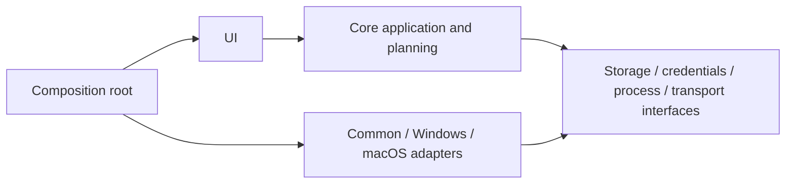

# Architecture

## Current structure

`Program.cs` composes the Avalonia app. `PlannerWindow` partials connect ribbon/menu actions, tables, views, formatting and dialogs. `ProjectSession` owns the editable OfficeIMO model and Undo/Redo; `DurableCommands` provides an explicit replay allowlist. `PlanoraPackage` stores original bytes plus bounded, hashed history/presentation records. `RecoveryStore` manages isolated slots and a previous generation. AI/MCP clients and credential/process integrations are separate modules but still share the app assembly.

This is a source snapshot, not a completed clean-architecture refactor. Model, UI, persistence and platform seams need further separation. In particular, durable state currently references presentation types.

## Target direction

A future migration can introduce `src/Planora.Core`, `src/Planora.Interfaces`, `src/Planora.Platform.*`, `src/Planora.Desktop` and focused test projects. Keep each step runnable. First characterize model commands and persistence; extract pure logic; introduce interfaces at existing seams; move adapters; finally thin UI composition. Do not rewrite the app in Python or silently migrate repository paths.

Current paths are intentionally preserved because the application and test harnesses reference `project-app/`. A structural migration requires a reviewed mapping and approval as requested by the project owner. This upload preparation only adds repository scaffolding and preserves source behavior.

## Future mobile clients

The owner confirmed Android and iOS development after macOS completion and validation. Keep reusable project/scheduling logic and persistence contracts separate from desktop widgets and OS integrations so mobile clients can reuse qualified logic. Framework choice and code-sharing feasibility require an explicit evaluation after that gate; no mobile framework or desktop-UI reuse is assumed. Mobile credentials, file providers, lifecycle and touch UI need dedicated adapters. [Mobile plan](MOBILE-PLAN.md).
